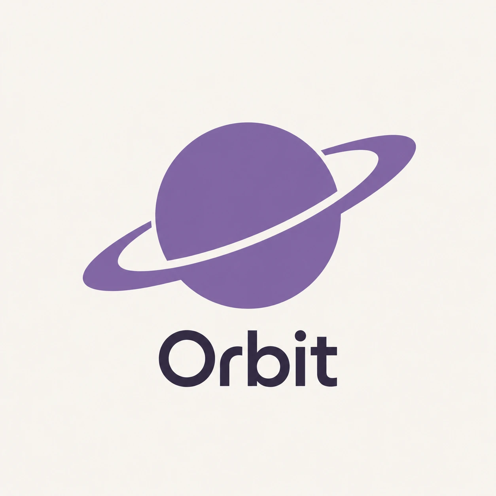

<p align="center">
  
</p>

# Orbit

Orbit is a native macOS menu bar app that shows a radial wheel while you drag files, so you can convert and edit them by dropping onto a slice. It works entirely on your Mac: no network access, no telemetry, and no Accessibility or Input Monitoring permission.

<p align="center">
  <a href="docs/demo/orbit-demo.mp4"></a>
  <br>
  <sub><a href="docs/demo/orbit-demo.mp4">Watch the demo with sound (24 s)</a></sub>
</p>

Requires macOS 14 or later. On macOS 26 the wheel uses Liquid Glass; earlier systems get a frosted-material fallback.

## How it works

Start dragging one or more files in Finder (or on the Desktop), then press a trigger key **after** the drag has begun. The wheel opens under the pointer and stays open when you let go of the key. Move toward a slice and drop. Dropping on the centre hub cancels; dropping outside the wheel goes to whatever is underneath, as a normal drag.

| Wheel | Default keys | What it holds |
|---|---|---|
| **Convert** | Hold Shift **or** ⌘ | Output formats for the dragged file type |
| **Tools** | Hold Shift+⌥ **or** ⌥⌘ | Editing, cleanup and optimization tools |
| **Actions** | Tap Control | Float, AirDrop, Copy Path, Terminal, Copy to, Move to, Archive |

- Pressing another trigger while the wheel is open switches to that wheel in place.
- Holding a slice briefly opens a sub-ring (compression tiers, favourite folders, speed values).
- Several files of the same kind are processed as one batch with one progress panel; mixed selections and folders offer ZIP, TAR and TAR.GZ, and Actions works on anything.
- Prefer the keyboard? Right-click files, choose **Quick Actions → Orbit…**, or use **Open Files…** in the menu bar. Arrow keys move the highlight, Return applies, Escape closes, and ⌘, ⌥ and Control switch wheels.

Results are saved beside the original as `name-<suffix>.<ext>` (for example `photo-converted.png` or `clip-compressed.mp4`). Nothing is ever overwritten: a name collision becomes `-2`, `-3`, and so on, and an unwritable folder falls back to `~/Downloads/Orbit/`. Orbit never modifies a source file; the one exception is **Move to**, which relocates it. A toast offers **Open**, **Show in Finder** and **Undo**.

## Build and install

```sh
scripts/build-app.sh && scripts/install.sh
```

`build-app.sh` produces a universal (arm64 + x86_64) `build/Orbit.app`, signed as described below; `install.sh` copies it to `/Applications` (refusing to replace anything that isn't Orbit) and launches it. Use `scripts/build-app.sh --debug` for a plain debug build. Tests run with `swift test`.

### Code signing

macOS remembers which folders (Desktop, Documents, Downloads) you let Orbit read by the app's code-signing identity. An ad-hoc signature changes with every build, so macOS asks again after each rebuild. Sign with a real certificate and the grants stick. `build-app.sh` picks the identity in this order:

1. the `ORBIT_SIGN_IDENTITY` environment variable;
2. the first line of a git-ignored `.orbit-signing` file at the repo root;
3. ad-hoc (`-`), with a warning that macOS will re-ask for folder access after every rebuild.

An identity is a certificate name or SHA-1 hash from `security find-identity -v -p codesigning`:

```sh
ORBIT_SIGN_IDENTITY="Apple Development: Your Name (TEAMID)" scripts/build-app.sh
echo "<SHA-1 or name from security find-identity>" > .orbit-signing   # or keep it in a file
```

`.orbit-signing` is per checkout: copy it into any new clone or worktree. An identity that is not in your keychain stops the build before anything is replaced. Blank lines and `#` comments in the file are ignored.

The script prints the identity it used and the app's designated requirement; with a real identity that names the certificate, not a cdhash. The first time `codesign` uses a keychain key, macOS may ask whether `codesign` can access it: click **Always Allow**.

## Optional helpers

Orbit works without these; slices that need a missing helper are hidden and the hub says what to install.

- **ffmpeg**, for MKV, WebM, AVI, WMV, MP3, OGG, Opus and WMA: `brew install ffmpeg`. Orbit looks at the custom path from Settings, then `/opt/homebrew/bin/ffmpeg`, then `/usr/local/bin/ffmpeg`. It is never bundled.
- **Pages, Keynote and Numbers**, from the Mac App Store, for PAGES, NUMBERS and KEY output, slide decks, and reading XLSX, XLS and NUMBERS spreadsheets. Their slices appear only when the app is installed.

## First run

- The first time you use an iWork-backed slice, macOS asks whether Orbit may control Pages, Keynote or Numbers (an Automation prompt). Allow it; it is asked once per app.
- Orbit watches the drag pasteboard and the mouse, which need no permission.
- On first launch Orbit offers to turn on **Full Disk Access** (System Settings → Privacy & Security), so macOS stops asking separately for each folder. Choosing **Not now** is fine; you will be asked per folder instead. Settings → General shows the status and can reopen the welcome.
- Orbit is not notarized (and ad-hoc signed unless you built it with a signing identity). If macOS blocks the first launch, right-click the app and choose **Open**.

## Settings

Open **Settings…** from the menu bar icon.

- **Triggers:** record the key combination for each wheel.
- **Output:** reveal results in Finder; quality defaults for JPEG, HEIC, WebP and AVIF; PDF-to-image resolution; presets for compression and "fit under" sizes.
- **Copy / Move:** favourite folders for the Copy to and Move to sub-rings (Desktop, Documents and Downloads by default).
- **Terminal:** which terminal app the Terminal action opens (Terminal, iTerm, Ghostty or Warp).
- **Helpers:** whether ffmpeg, Pages, Keynote and Numbers were found, with a one-line way to get each.
- **General:** launch at login, haptic feedback, and the **accent colour** (default `#80649C`) used for the wheel's highlight and the editors' controls. It comes with a colour well, the hex value and a reset button.

The menu bar menu also has an **Enabled** toggle, **Recent results** (the last 10) and **Quit**.

## Logs

`~/Library/Logs/Orbit/orbit.log`. Run the app with `--diagnose-trigger` to log every trigger input sample and drop callback there.

## License

MIT. See [LICENSE](LICENSE). © k-gdev.
